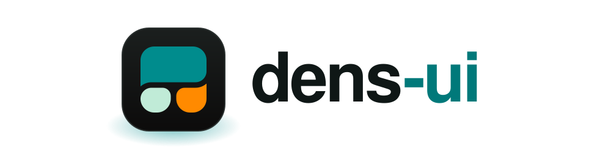
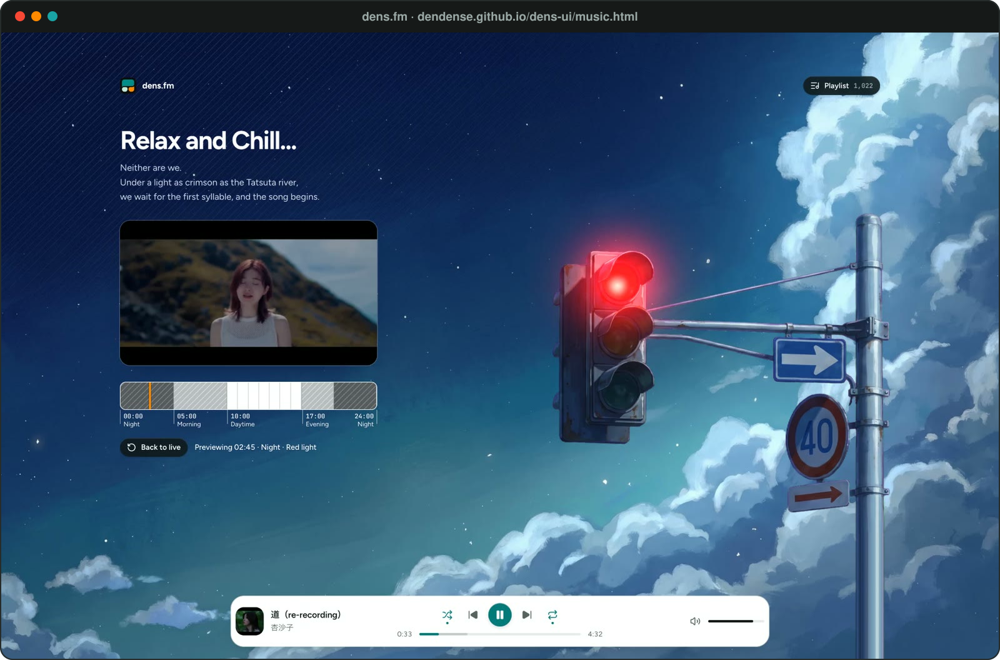

<p align="center">
  <picture>
    <source media="(prefers-color-scheme: dark)" srcset="docs/assets/readme-header-dark.svg">
    
  </picture>
</p>

<h3 align="center">Don't start from unstyled primitives. Copy a finished look, and own every line.</h3>

<p align="center">
  <a href="https://dendense.github.io/dens-ui"></a>
  <a href="https://github.com/dendense/dens-ui/actions/workflows/deploy.yml"></a>
  
  
  <a href="#quick-start"></a>
  
  <a href="LICENSE"></a>
</p>

Starting a dashboard from unstyled primitives costs days of picking colours, radii and shadows before the first real screen, and most projects still end up with the same grey defaults.

**Dens-UI** is a set of React components and a theme you copy into your project, the [shadcn/ui](https://ui.shadcn.com) way: Mars Green `#008C8D`, *one* Hermès orange accent `#FF8A00`, soft light panels and a near-black dark mode. One command adds a component, and the code is yours to edit. There is no `dens-ui` npm package.

<p align="center">
  <a href="https://dendense.github.io/dens-ui/music.html">
    
  </a>
</p>
<p align="center">
  <sub><b>dens.fm</b>, a music landing built with Dens-UI: <code>MusicPlayer</code>, <code>MusicPlaylist</code>, <code>Button</code> and <code>Input</code> over a three.js sky.
  <a href="https://dendense.github.io/dens-ui/music.html">Open it live</a> · <a href="src/music">Source</a></sub>
</p>

<p align="center">
  <a href="https://dendense.github.io/dens-ui"><b>Docs and live previews</b></a> ·
  <a href="#quick-start">Quick start</a> ·
  <a href="#using-the-style">Using the style</a> ·
  <a href="#desktop-apps">Desktop apps</a> ·
  <a href="#panduan-singkat-bahasa-indonesia">Bahasa Indonesia</a>
</p>

## What's inside

- **30 components**: Button, Badge, Card, Post Card, Input, Textarea, Label, Checkbox, Switch, Radio Group, Select, Slider, Tabs, Dialog, Dropdown Menu, Tooltip, Avatar, Progress, Alert, Table, Chart, Navbar, Footer, Sidebar (with folders, an icon rail and a 24h meter), Separator, Divider, Kbd, Skeleton (text, image and post-card shapes), Music Player, Video Player
- **Charts without a chart library**: candlesticks for trading, area, bar, donut, bar list and a segmented share bar
- **Media**: a music player (Now Playing card, mini row, app bottom bar, playlist with search) that any engine can drive, and a video player with captions, speed, picture in picture and full screen
- **5 blocks**: hero (photo and split), footer (sheet and simple), an ops dashboard, a split login screen, two mobile app screens
- **A shadcn-compatible registry**, so `npx shadcn add <url>` installs any of it
- **Light and dark mode** from one stylesheet, with the same token names shadcn/ui uses

---

## Quick start

You need a React project with Tailwind CSS v4 and the `@/` path alias. If you have not used shadcn/ui in the project yet:

```bash
npx shadcn@latest init
```

### 1. Add the theme

```bash
npx shadcn@latest add https://dendense.github.io/dens-ui/r/theme.json
```

This writes `src/styles/dens-ui.css` and installs the Figtree and JetBrains Mono variable fonts. Import it in your global stylesheet, right after Tailwind:

```css
/* src/index.css (or app/globals.css) */
@import "tailwindcss";
@import "@fontsource-variable/figtree";
@import "@fontsource-variable/jetbrains-mono";
@import "./styles/dens-ui.css";
```

If `shadcn init` already wrote `:root` / `.dark` variables into that file, delete them. Dens-UI defines the same names.

### 2. Add components

```bash
npx shadcn@latest add https://dendense.github.io/dens-ui/r/button.json
npx shadcn@latest add https://dendense.github.io/dens-ui/r/card.json https://dendense.github.io/dens-ui/r/tabs.json

# or everything
npx shadcn@latest add https://dendense.github.io/dens-ui/r/all.json
```

Registry files live at `https://dendense.github.io/dens-ui/r/<name>.json`. The names are the file names in [`src/components/ui`](src/components/ui).

### 3. Use them

```tsx
import { Button } from "@/components/ui/button"
import { Badge, StatusDot } from "@/components/ui/badge"

export function Example() {
  return (
    <div className="flex items-center gap-3">
      <Button>New workflow</Button>
      <Button variant="ink">Approve</Button>
      <Badge variant="soft"><StatusDot /> Healthy</Badge>
    </div>
  )
}
```

### Manual install

Copy [`src/styles/dens-ui.css`](src/styles/dens-ui.css), [`src/lib/utils.ts`](src/lib/utils.ts) and the component files you want from [`src/components/ui`](src/components/ui), then install what they import:

```bash
npm install radix-ui class-variance-authority clsx tailwind-merge lucide-react \
  @fontsource-variable/figtree @fontsource-variable/jetbrains-mono
```

### Dark mode

Class-based. Put `dark` on `<html>`:

```ts
document.documentElement.classList.toggle("dark", prefersDark)
```

### Desktop apps

Dens-UI runs unchanged in any desktop shell that renders a webview. Full guide: [Desktop apps](https://dendense.github.io/dens-ui/#/docs/desktop).

| Shell | Language | What you reuse |
| --- | --- | --- |
| Tauri 2 | Rust | Everything: theme, components, blocks |
| Electron | JS / TS | Everything |
| Wails | Go | Everything |
| Dioxus, Leptos | Rust | `dens-ui.css` and the class names; components are rewritten in RSX |
| egui, iced, Slint, GTK 4 | Rust | Colour, radius and spacing values only |

Tauri in short:

```bash
npm create tauri-app@latest my-app -- --template react-ts --manager npm
cd my-app && npm install
npm install tailwindcss @tailwindcss/vite
npx shadcn@latest init
npx shadcn@latest add https://dendense.github.io/dens-ui/r/theme.json https://dendense.github.io/dens-ui/r/all.json
npm run tauri dev
```

Add `tailwindcss()` and the `@` alias to `vite.config.ts`, and keep Vite's default `base` (`/`). This repo uses `base: "/dens-ui/"` only for GitHub Pages. On Linux the webview is WebKitGTK: if `backdrop-blur` (Dialog overlay, glass Navbar) is slow on your GPU, swap it for a solid `bg-card`.

---

## Using the style

The full guide is in [docs/STYLE-GUIDE.md](docs/STYLE-GUIDE.md), and the machine-readable design system (tokens in frontmatter, named rules) is in [DESIGN.md](DESIGN.md). The short version:

| Token (CSS variable) | Tailwind class | Light | Dark | Use it for |
| --- | --- | --- | --- | --- |
| `--background` | `bg-background` | `#edf0ef` | `#0c0b0b` | Page ground |
| `--surface` | `bg-surface` | `#f5f7f6` | `#121514` | Recessed wells inside panels |
| `--card` | `bg-card` | `#ffffff` | `#161918` | Panels, menus, dialogs |
| `--foreground` | `text-foreground` | `#0f1716` | `#ecf2f0` | Text, the ink button |
| `--muted-foreground` | `text-muted-foreground` | `#566361` | `#9aa8a5` | Secondary text |
| `--brand` | `bg-brand` | `#008c8d` | `#008c8d` | Mars Green fills (large areas) |
| `--primary` | `bg-primary` | `#00797a` | `#19a3a4` | Primary actions, links, focus |
| `--highlight` | `bg-highlight` | `#ff8a00` | `#ff9a1f` | The one accent: things waiting on the user |
| `--soft` | `bg-soft` | `#c0ebd7` | `#123f3a` | Mint fills, success |
| `--warning` | `bg-warning` | `#ebe3a5` | `#39340f` | Champagne |
| `--info` | `bg-info` | `#0b3289` | `#15296a` | Klein blue |
| `--destructive` | `bg-destructive` | `#a42423` | `#f74835` | Cartier red / pomegranate |

Rules that keep it looking like Dens-UI:

1. **Mars Green does the work.** Primary actions, focus rings, selection and the first chart series.
2. **Orange is rare.** Use `highlight` only where something is waiting on the reader: a pending approval, a slowdown, an unread count.
3. **One brand panel per screen.** `<Card variant="brand">` is a statement; do not tile it.
4. **Pills for controls, big radii for panels.** Buttons, badges and segmented tabs are `rounded-full`; cards are `rounded-2xl` (22px); dialogs `rounded-3xl`.
5. **Soft, offset shadows.** `shadow-panel` for resting cards, `shadow-raised` for menus, dialogs and the one item that needs attention.
6. **Figtree for words, JetBrains Mono for data.** IDs, timestamps, hex values and table heads go mono; numbers use `tabular-nums`.

---

## Develop this repo

```bash
npm install
npm run dev        # docs site at http://localhost:5173/dens-ui/
npm run registry   # rebuild public/r/*.json from src/components/ui
npm run build      # registry + typecheck + static site in dist/
```

```
src/
  styles/dens-ui.css     the theme (what consumers install)
  lib/utils.ts           cn()
  components/ui/         the components (what consumers install)
  site/                  the docs website (not shipped to consumers)
    demos/               one demo file per component, shown in the Code tab
    blocks/              dashboard, login, mobile
scripts/build-registry.mjs   writes public/r/*.json for the shadcn CLI
```

Pushing to `main` builds the site and deploys it to GitHub Pages (`.github/workflows/deploy.yml`).

### Banner images for the Hero blocks

The Hero blocks look for photos in `src/site/assets/local/` (`hero-photo`, `thumb-1`, `hero-portrait`, `portrait-thumb`, as `.jpg`, `.png` or `.webp`). That folder is **gitignored**: drop in your own or licensed photos for local work, and they never reach the public repo.

When a file is missing, as on the public site, the slot shows a dot-matrix cat instead:
- **Large slots:** the cat is animated with three.js. three.js is lazy-loaded in its own chunk, the animation pauses offscreen, and it renders one still frame under `prefers-reduced-motion`.
- **Thumbnails:** a static SVG of the same cat.

---

## Panduan singkat (Bahasa Indonesia)

1. Siapkan proyek React + Tailwind v4, lalu jalankan `npx shadcn@latest init` bila belum.
2. Pasang tema: `npx shadcn@latest add https://dendense.github.io/dens-ui/r/theme.json`, lalu impor `dens-ui.css` setelah `@import "tailwindcss"` di CSS global.
3. Pasang komponen satu per satu, misalnya `npx shadcn@latest add https://dendense.github.io/dens-ui/r/button.json`, atau semuanya lewat `all.json`.
4. Mode gelap: tambahkan class `dark` pada `<html>`.
5. Aplikasi desktop: pakai Tauri (Rust), Electron, atau Wails. Komponen jalan apa adanya di webview. Dioxus/Leptos hanya memakai `dens-ui.css` dan class-nya. egui/iced/GTK hanya memakai nilai warna dan radius. Panduan: [Desktop apps](https://dendense.github.io/dens-ui/#/docs/desktop).
6. Aturan gaya: hijau Mars untuk aksi utama, oranye Hermès hanya untuk hal yang menunggu tindakan pengguna, satu panel `brand` per layar. Detail lengkap ada di [docs/STYLE-GUIDE.md](docs/STYLE-GUIDE.md).

---

Palette from the "Mars Green" colour study in the project references. Demo names and figures in the blocks are fictional.

MIT © Denslab
